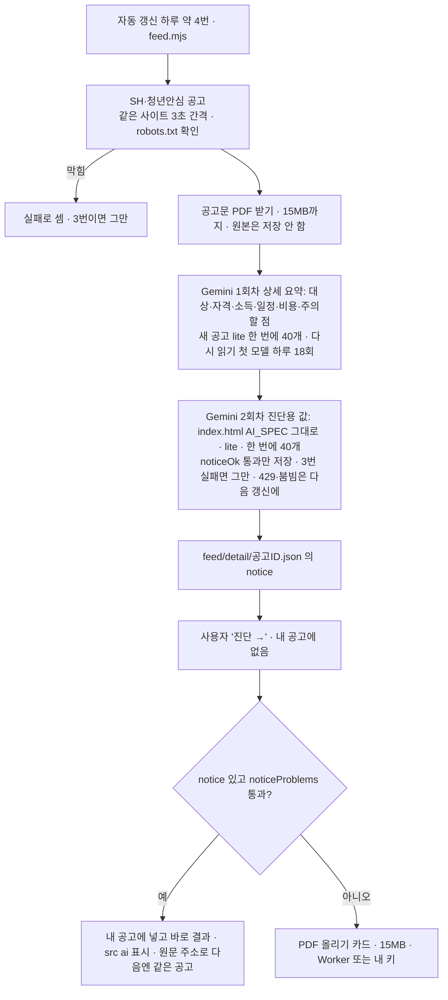

# 공고 상세 — 공고문 자동 읽기 · 진단용 값 · PDF 올리기 (2026-11-16)

- 원문(PDF+본문 해시)이 바뀌어 상세를 새로 읽으면 notice 는 버리고 다시 읽음
- 마이홈은 API 기본 정보로 상세(AI 안 씀) · LH·엘리스는 공고문 경로가 없어 원문 링크만
- 코드: `scripts/feed.mjs`(대상) · `scripts/detail.mjs`(`get` = polite + robotsOk · `noticeSpec` · `noticeOk` · 진단용 값 반복) · `scripts/net.mjs` · 사이트 `[data-diag]` 클릭 · `normDet` · sjcu `worker/src/index.js` `MAX_PDF`
- 검사: `node scripts/verify/detail_check.mjs`(진단용 값 7개 · 기존 검사는 `DETAIL_NOTICE=0`·`DETAIL_MAX_FRESH=5`) · `check.py`(미리 읽은 값으로 바로 진단 · 모자라면 카드) · sjcu `worker_check.mjs`
