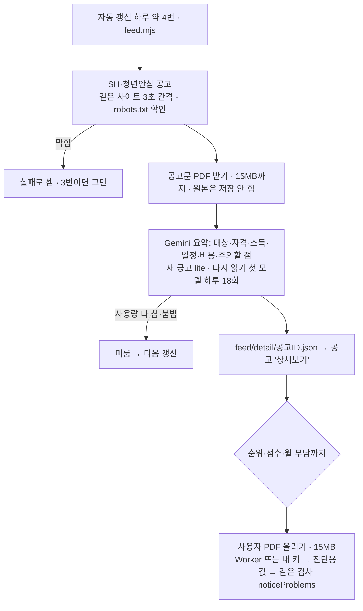

# 공고 상세 — 공고문 자동 읽기 · PDF 올리기 (2026-11-16)

- 마이홈은 API 기본 정보로 상세(AI 안 씀) · LH·엘리스는 공고문 경로가 없어 원문 링크만
- 코드: `scripts/feed.mjs`(대상) · `scripts/detail.mjs`(`get` = polite + robotsOk) · `scripts/net.mjs` · 사이트 `#subPdf` · sjcu `worker/src/index.js` `MAX_PDF`
- 검사: `node scripts/verify/detail_check.mjs` · sjcu `node scripts/verify/worker_check.mjs`
