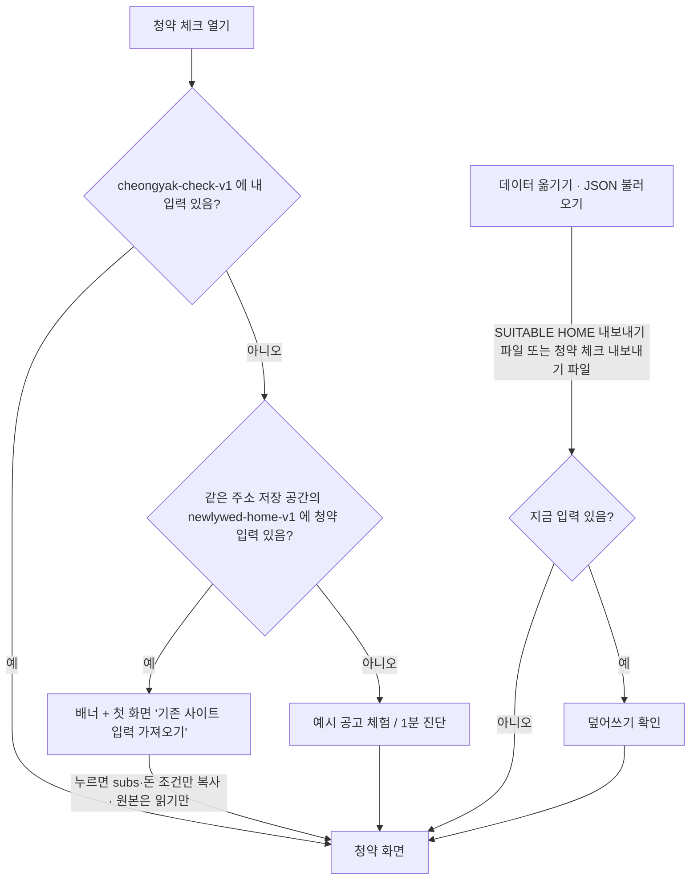
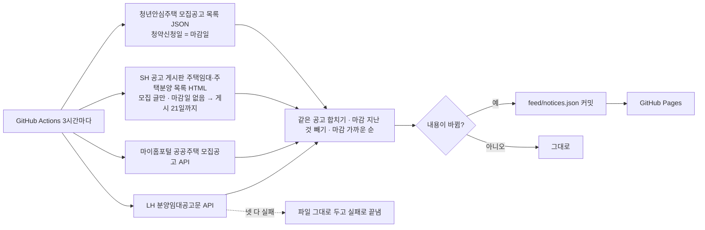
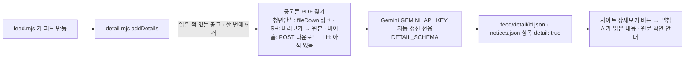

# 청약 체크 — SUITABLE HOME 에서 청약 떼어 내기 (2026-11-06)

## 결정

- 지역: 서울 공고만 (2026-11-06 사용자 결정) — 피드는 API 요청·합친 뒤 두 번 거르고, 공고 추가·가져오기도 서울 밖은 막음
- 이름(가칭) `cheongyak-check`, 주소 `dionelee.github.io/cheongyak-check/`, 저장 키 `cheongyak-check-v1`. "청약Home"과 헷갈리는 이름은 쓰지 않는다
- 판정·계산·AI 읽기 코드는 SUITABLE HOME index.html 에서 그대로 옮김 (바꾼 곳: 문구 "우리/예시 가족" → "내 상황/예시 상황", 매물 비교 연결 → SUITABLE HOME 링크, 공고 목록 위치, 피드 5개)
- 기존 사이트 청약 탭은 지우지 않고 맨 위 안내 한 줄만 (공모전 심사 2027-01-20까지 기존 기능 유지)
- 디자인: 클린 라이트 + 딥 포레스트 그린 (안티그래비티 명세). 세부 폴리싱·아이콘은 안티그래비티
- 공고 피드: GitHub Actions + 공식 API(마이홈포털·LH) + SH 공고 게시판 + 서울 청년안심주택 모집공고 목록 JSON (2026-11-06 추가: 서울 공고는 둘의 비중이 큰데 API 에 없음). 기존 `push-feed.ps1` 은 SUITABLE HOME 용으로만 당분간 유지
- 서비스 워커: index.html·피드 = 인터넷 먼저(실패 시 저장본), 나머지 = 저장본 먼저, 저장소 이름에 VERSION

## 기존 입력 가져오기

같은 주소(dionelee.github.io)면 저장 공간을 같이 쓰므로 버튼 한 번으로, 다른 도메인으로 옮기면 JSON 파일로 옮긴다.

## 공고 피드

## 공고 상세 (상세보기, 2026-11-07)

피드백: "공고를 내가 직접 넣는 게 아니라 상세보기를 누르면 조건을 보여 줬으면"

- 한 번 읽은 공고는 다시 읽지 않음 · 3번 실패하면 그만(`_fail.json`) · 429 면 그 실행은 멈춤 · 피드에서 빠진 공고의 상세는 지움
- 상세 내용: 신청 대상 · 자격 · 소득/자산/자동차 · 주택형·가격 · 일정 · 특이사항(가점·한부모·세대 분리 등) · 문의
- 모델 기록(2026-11-07): 상세 파일에 `model`·`readAt` · 첫 모델(gemini-3.6-flash)이 아닌 모델이 읽었거나 예전 방법(v < DETAIL_V)이면 다음 갱신 때 **첫 모델로만** 다시 읽음 · 첫 모델 사용량이 다 차면 새 공고 첫 읽기만 lite 로, 다시 읽기는 미룸
- 퇴보 막기: 다시 읽은 결과는 칸마다 합침 — 목록(자격·특이사항·주택형·일정·비용)은 항목이 더 많은 쪽, 한 줄 칸은 새 값이 비면 예전 값 (`mergeDetail`)
- 마이홈포털(캠코 등): 해외 서버에서 상세 페이지가 시간 초과 → 공고문 PDF 대신 마이홈 API 한 줄의 기본 정보(단지·보증금·계약금·월임대료·접수·당첨 발표·문의·주소)로 상세(`source: 'api'`, AI 안 씀). API 에 상세 조회·자격 조건·첨부 주소는 없음 (2026-11-07 `probe_myhome` 확인)
- 상세가 없는 공고(LH 등)는 [공고 원문 보기] 링크
- 다음 단계(안 함): 청년·신혼부부 임대 공고는 판정용 공고 JSON(NOTICE_SCHEMA)도 읽어 '이 공고로 내 조건 진단' 버튼

## 화면 (PC 1280 / 휴대폰 390)

2026-11-06 피드백 반영: "첫 화면은 공고문 링크 바로가기, 진단은 둘째 · 설명 빼고 간단하게"

- 위: 앱 바(56px, 칩: 공고 바로가기 · 순위·점수 진단 · AI 설정)
- PC·휴대폰 모두 한 줄 기둥(최대 880px)
  1. **서울 청약 공고 바로가기**: 마감 전 서울 공고 피드(공고문 링크 ↗ · D-day, 5개 + 더 보기) → 원문 사이트 4곳(LH·SH·청년안심주택·마이홈포털)
  2. **내 청약 순위·점수 진단해보기**: 제목 바로 밑에 공고문 PDF 올리기(직접 붙여넣기 · 예시 공고) → 내 공고(있을 때만, 가로 넘김) → 질문 7개(첫 방문부터 펼침) 또는 내 조건 요약 · 신호등 카드 → 돈 조건
- 신호등 카드 아코디언 3개(기본 닫힘): 보증금 대출·내 돈 계산기 / 다른 보증금 비율·주택형 / 판정 근거
- 맨 아래 접힘: AI 설정 · 데이터 옮기기 · 고급(공고 JSON)
- 뺀 것: 첫 화면 긴 설명·진단/체험 큰 버튼·유형 줄, "이렇게 진단해요" 3단계 카드, PC 왼쪽 고정 칸

## 알려진 한계

- 피드 API 를 GitHub(해외 서버)에서 부를 수 있는지는 첫 실행에서 확인 필요
- 판정 코드가 두 사이트에 복사돼 있다. 판정 규칙을 고치면 두 곳 모두 고치고 `check.py` 동등성 검사로 확인 (2027-01-20 이후 SUITABLE HOME 청약 탭을 링크로 바꾸면 한 곳만 남김)
