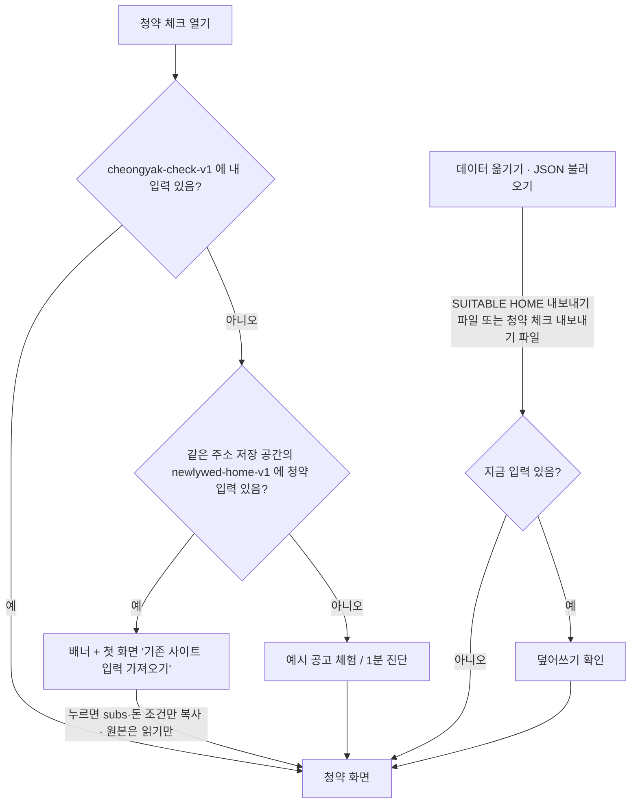
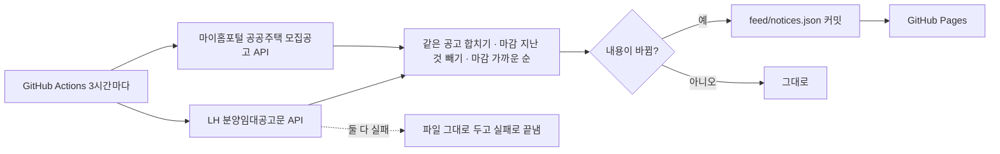

# 청약 체크 — SUITABLE HOME 에서 청약 떼어 내기 (2026-11-06)

## 결정

- 지역: 서울 공고만 (2026-11-06 사용자 결정) — 피드는 API 요청·합친 뒤 두 번 거르고, 공고 추가·가져오기도 서울 밖은 막음
- 이름(가칭) `cheongyak-check`, 주소 `dionelee.github.io/cheongyak-check/`, 저장 키 `cheongyak-check-v1`. "청약Home"과 헷갈리는 이름은 쓰지 않는다
- 판정·계산·AI 읽기 코드는 SUITABLE HOME index.html 에서 그대로 옮김 (바꾼 곳: 문구 "우리/예시 가족" → "내 상황/예시 상황", 매물 비교 연결 → SUITABLE HOME 링크, 공고 목록 위치, 피드 5개)
- 기존 사이트 청약 탭은 지우지 않고 맨 위 안내 한 줄만 (공모전 심사 2027-01-20까지 기존 기능 유지)
- 디자인: 클린 라이트 + 딥 포레스트 그린 (안티그래비티 명세). 세부 폴리싱·아이콘은 안티그래비티
- 공고 피드: GitHub Actions + 공식 API(마이홈포털·LH)만. SH·청년안심주택은 원문 링크만. 기존 `push-feed.ps1` 은 SUITABLE HOME 용으로만 당분간 유지
- 서비스 워커: index.html·피드 = 인터넷 먼저(실패 시 저장본), 나머지 = 저장본 먼저, 저장소 이름에 VERSION

## 기존 입력 가져오기

같은 주소(dionelee.github.io)면 저장 공간을 같이 쓰므로 버튼 한 번으로, 다른 도메인으로 옮기면 JSON 파일로 옮긴다.

## 공고 피드

## 화면 (PC 1280 / 휴대폰 390)

- 위: 앱 바(56px, 빠른 이동 칩) → 첫 화면(한 줄 요약 · D-day · 가져오기/1분 진단/예시 체험 · 유형 + 준비 중)
- PC 960px 이상: 왼쪽 320px 고정(내 공고 · 새 공고 피드 5개 · 원문 링크) / 오른쪽(가져오기 배너 · 질문 또는 내 조건 요약 · 유형 탭 · 신호등 카드 · 돈 조건)
- 휴대폰: 내 공고(가로 넘김) → 진단 → 피드 → 원문 링크
- 신호등 카드 아코디언 3개(기본 닫힘): 보증금 대출·내 돈 계산기 / 다른 보증금 비율·주택형 / 판정 근거
- 맨 아래 접힘: AI 설정 · 데이터 옮기기 · 고급(공고 JSON)

## 알려진 한계

- 피드 API 를 GitHub(해외 서버)에서 부를 수 있는지는 첫 실행에서 확인 필요
- 판정 코드가 두 사이트에 복사돼 있다. 판정 규칙을 고치면 두 곳 모두 고치고 `check.py` 동등성 검사로 확인 (2027-01-20 이후 SUITABLE HOME 청약 탭을 링크로 바꾸면 한 곳만 남김)
