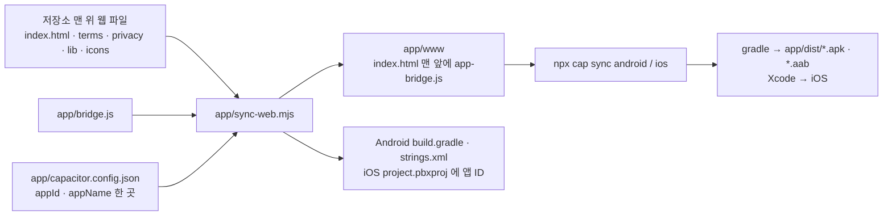
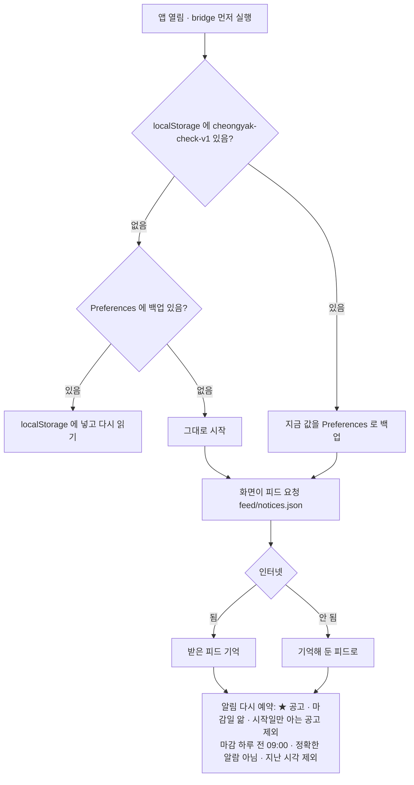

# 앱 (Android · iOS) — Capacitor (2026-11-09)

웹사이트 파일을 그대로 앱 안에 넣는다(`app/www`, `sync-web` 이 복사). 앱에서만 필요한 일은 `app/bridge.js` 가 하고, 웹사이트에는 들어가지 않는다.
웹 `index.html` 의 앱 분기는 `IS_APP`/`SITE` 한 군데뿐 (앱이면 공고 피드·상세·구독 캘린더를 github.io 에서).

## 만들기

## 앱이 켜질 때 (bridge.js)

- 저장할 때마다(`setItem`) `cheongyak-check-v1` 은 Preferences 에도 저장. 되살리는 중에는 백업하지 않음(빈 상태가 백업을 덮지 않게)
- 처음 ★ 를 켤 때 한 번 알림 허용을 묻는다(`cheongyak-check-app-notif-asked`). 허용 안 하면 예약 안 함
- 파일 받기(.ics · 내보내기 JSON): WebView 는 blob 다운로드를 못 함 → 앱 임시 폴더에 쓰고 공유 시트
- Android 뒤로 버튼: WebView 가 해시 이동을 기록으로 안 봐서 직접 — 공고 탭이면 앱 닫기, 아니면 이전 탭(없으면 공고 탭)
- 정확한 알람 권한(`SCHEDULE_EXACT_ALARM`)은 AndroidManifest 에서 뺌 (Play 정책상 알람·캘린더 앱용). 그래서 알림은 `isExactNotification: false`

## 바깥과의 연결

| 무엇 | 앱에서 | 비고 |
|---|---|---|
| 공고 피드·상세·구독 캘린더 | `https://dionelee.github.io/cheongyak-check/feed/…` | GitHub Pages 는 CORS `*` |
| AI 공고문 읽기 | 같은 Worker `suitable-home-ai` | Worker 허용 주소에 `https://localhost`(Android)·`capacitor://localhost`(iOS) 추가 필요 → sjcu `worker/src/index.js` (배포는 사용자) |
| 공고 원문 링크 | 시스템 브라우저 | Capacitor 기본 (앱 밖 주소는 외부로) |
| 저장 | WebView localStorage + Preferences 한 벌 | 웹과 앱은 저장 공간이 따로 → 옮길 때 내보내기/불러오기 |

검사: `node scripts/verify/app_bridge_check.mjs` (가짜 Capacitor · 21개) · 에뮬레이터는 `scripts/verify/app_cdp.mjs` 로 앱 화면 안에서 JS 실행
