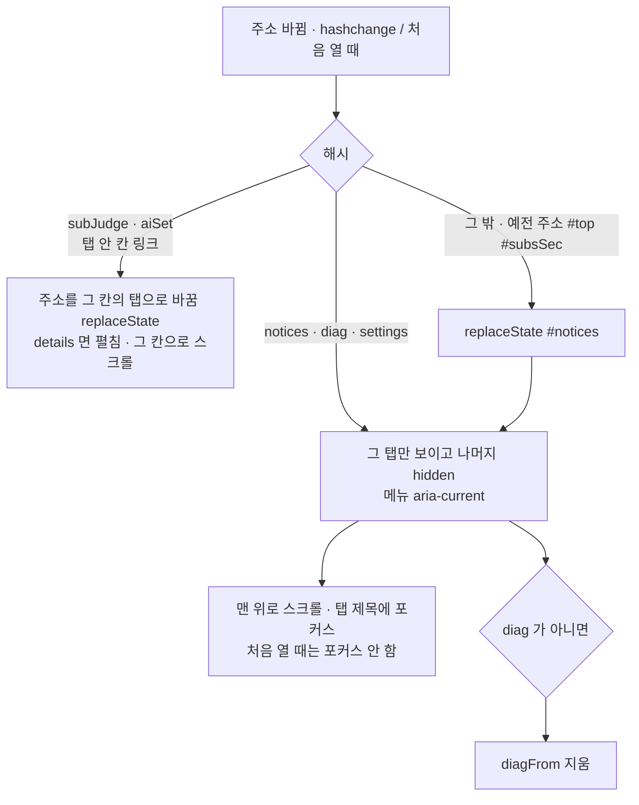
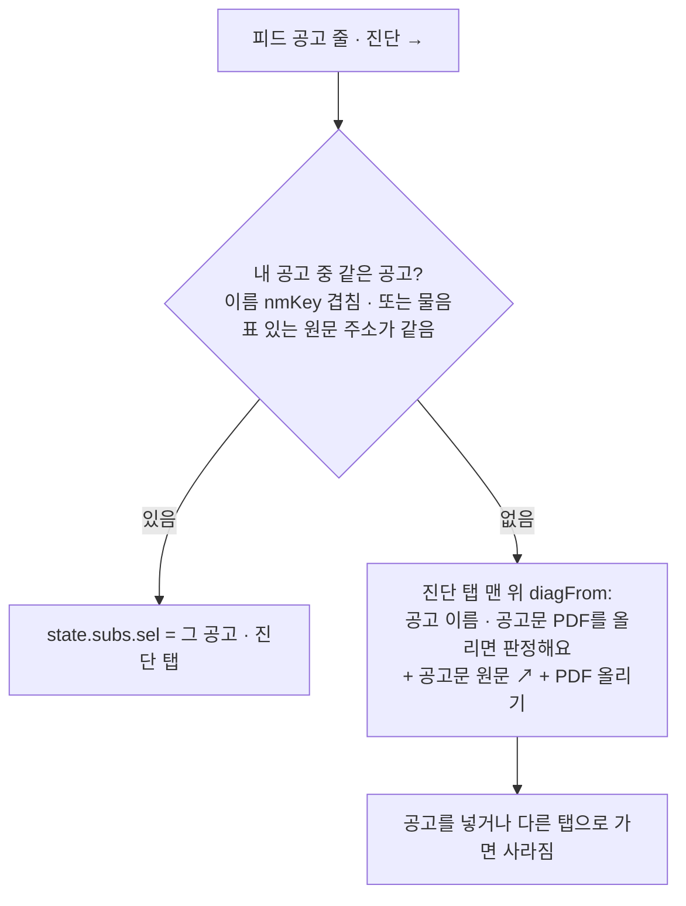
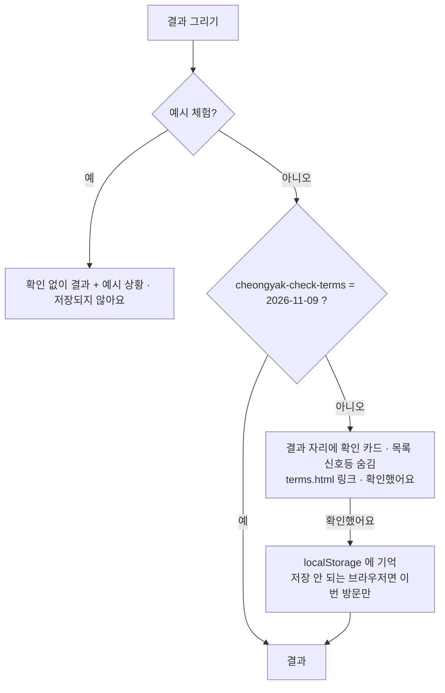

# 탭 3개 · 판정 문구 (sw 09b, 2026-11-09)

한 페이지 스크롤을 주소별 탭 3개로 나누고, 판정 결과 문구를 "입력한 조건 기준 예비 판정"으로 바꿨다. 판정·계산 코드는 그대로.

## 탭 이동

- 탭은 숨기기만 한다 (다시 그리지 않음) → 질문 진행 · 입력값 · 필터 그대로
- 뒤로가기: 탭 이동은 `location.hash` 로 기록이 남는다. 이상한 주소 고치기는 replaceState (기록 안 남김)

## 공고 목록의 "진단 →"

## 결과 카드 (위에서부터)

1. 정정공고 (있을 때): 피드에 `정정·변경·재공고` 제목 + 이름 겹침 + 게시일 > 내 공고의 공고일 → "판정 기준일 이후 정정공고가 있어요 · 원문 확인 ↗"
2. 신호등: `SIG` — 신청 가능해 보여요 / … · 예산은 넘어요 / 아직 판단하기 어려워요 · 확인이 필요해요 / 어려워 보여요 (모두 "입력한 조건으로는 …")
3. 고정 한 줄: "예비 판정 · {short} 공고문 p.{cite.rules 의 쪽} 기준 · 최종 자격은 사업 주체 심사로 정해져요 · 공고문 원문 ↗" (쪽이 없으면 "공고문 기준")
4. AI 로 읽은 공고(`n.src === 'ai'`): "AI가 공고문을 읽어 만든 값이에요. 소득·자산 기준은 원문과 맞춰 보세요."
5. 이유 3줄 (이유 문구도 "… 가능해 보여요 / 어려워 보여요")
6. 어려워 보여요일 때: "이 판정만 보고 포기하지 말고 공고문이나 콜센터(LH 1600-1004, SH 1600-3456 등 · 청년안심주택은 공고문의 문의처)에서 확인하세요" + 원문 링크
   - 번호 확인 2026-11-09: lh.or.kr "콜센터 1600-1004" · i-sh.co.kr "대표전화 1600-3456"

## 이용약관 확인

- 약관 내용을 바꾸면 `TERMS_V` 를 올린다 → 모두 한 번 더 확인
- 배지 문구(피드): 기본 조건 맞아 보임 / 확인 필요 / 어려워 보임 · 판정 근거 배지: 가능해 보임 / 어려워 보임

## 판정 동등성

기준(SUITABLE HOME v28 백업)의 신호등·이유·배지 글자만 새 문구로 정확히 바꿔 놓고 비교한다 (`check.py` 의 `SIG_NEW` · `BADGE_NEW` · `wording_new`). 그 밖의 글자 차이는 실패.
